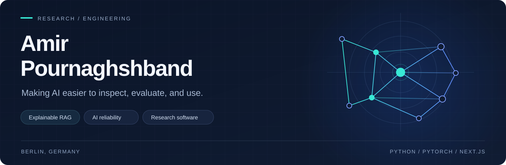

  

  <b>AI researcher · MSc Artificial Intelligence at BTU · Berlin, Germany</b> 
  Research experience at TU Berlin and BTU Cottbus–Senftenberg.

  
  
  

I work at the intersection of **AI research and software engineering**: making evidence behind RAG answers inspectable, evaluating neural-network security, and building useful research tools.

## Selected work

<table>
<tr>
<td width="50%" valign="top">
<h3>01 / TrustRAG</h3>
<b>See the evidence behind an AI answer.</b>

I contribute to an interactive research system where users select answer spans and inspect supporting sentences and word-level evidence.

Next.js · FastAPI · RAG · Attention attribution
</td>
<td width="50%" valign="top">
<h3>02 / Neural-network reliability</h3>
<b>Study how models fail — and how to recover them.</b>

Quantized-weight reconstruction with VGG/ResNet, partially known weights, and targeted bit-flip evaluation. I compare accuracy, fidelity, and robustness.

Python · PyTorch · GPU computing · SLURM
</td>
</tr>
<tr>
<td width="50%" valign="top">
<h3>03 / Literature Review Pipeline</h3>
<b>From scattered papers to a ranked reading list.</b>

A Python pipeline for scholarly retrieval, deduplication, LLM relevance ranking, and structured JSON/CSV exports.

<a href="https://github.com/BobbyBand/automated_literature_review"><b>Explore the repository →</b></a>

Python · Scholarly APIs · LLM ranking
</td>
<td width="50%" valign="top">
<h3>04 / Research websites</h3>
<b>Research groups and conferences, made accessible.</b>

I independently designed and developed the RSS Lab and DDECS 2027 websites: information architecture, responsive UI, content integration, deployment, and maintenance.

<a href="https://www.rss-lab.de"><b>RSS Lab →</b></a> &nbsp; <a href="https://ddecs.rss-lab.de"><b>DDECS 2027 →</b></a>

Web development · Responsive interfaces · Deployment
</td>
</tr>
</table>

## Tech stack

Tools I use across AI research, data pipelines, and software development.

<table>
<tr>
<td width="50%" valign="top">
<h3>⌘ &nbsp; Programming</h3>

<b>Python · JavaScript · C# · C++ · Bash</b> SQL for querying and application data.

</td>
<td width="50%" valign="top">
<h3>◈ &nbsp; Machine learning</h3>

<b>PyTorch · TensorFlow · scikit-learn</b> CNNs, transformers, forecasting, quantization, and model evaluation.

</td>
</tr>
<tr>
<td width="50%" valign="top">
<h3>▣ &nbsp; Web &amp; applications</h3>

<b>React · Next.js · Flask · FastAPI</b> HTML, CSS, and ASP.NET MVC.

</td>
<td width="50%" valign="top">
<h3>✦ &nbsp; LLMs &amp; explainability</h3>

<b>LangChain · RAG · Explainable AI</b> Evidence attribution, model extraction, weight reconstruction, and bit-flip evaluation.

</td>
</tr>
<tr>
<td width="50%" valign="top">
<h3>▥ &nbsp; Data &amp; experimentation</h3>

<b>NumPy · Pandas · SQL</b> Dataset design, annotation, cleaning, validation, experimental design, and statistical evaluation.

</td>
<td width="50%" valign="top">
<h3>⚙ &nbsp; Development &amp; computing</h3>

<b>Git · GitHub · Linux · Docker · Vercel · LaTeX</b> SLURM, HPC, MPI, multiprocessing, and MapReduce.

</td>
</tr>
</table>

<b>Additional familiarity</b>

LangGraph · Model Context Protocol (MCP) · Jev (TypeSafe AI)

---

  <b>Interested in AI/ML engineering, research engineering, and software opportunities.</b> 
  <a href="https://www.linkedin.com/in/amir-pournaghshband-3392301b1/">Let’s connect on LinkedIn →</a>

